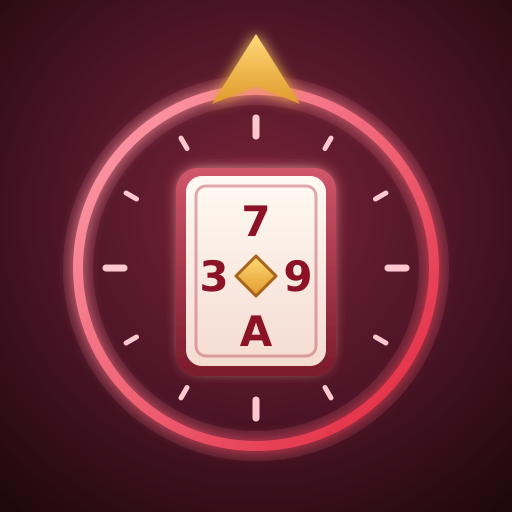

<p align="center">
  
</p>

<h1 align="center">Triple Triad Autopilot</h1>

<p align="center">
  <a href="https://github.com/Sojiroh/FFXIV-TripleTriadAutopilot/releases/latest"></a>
  <a href="https://github.com/Sojiroh/FFXIV-TripleTriadAutopilot/releases"></a>
  <a href="https://github.com/Sojiroh/FFXIV-TripleTriadAutopilot/actions/workflows/release.yml"></a>
  <a href="LICENSE.md"></a>
</p>

<p align="center">
  <em>Every NPC card, collected for you. Built on Dalamud.</em>
</p>

---

> **Fork notice.** Triple Triad Autopilot is a fork maintained by Sojiroh. It is not affiliated with or endorsed by XeldarAlz. Report problems here, not to the original author.
>
> ```text
> Based on Auto Triple Triad Grind by XeldarAlz
> https://github.com/XeldarAlz/FFXIV-AutoTripleTriadGrind
> ```

## What it does

Collects every Triple Triad card that NPCs can give you. You pick the cards you are missing (or whole NPCs), and the plugin travels to each NPC, builds a deck for its rules, plays until your cards drop, registers them, and moves on to the next one.

## Features

- **Collect mode.** Tick the cards you want and the plugin works out which NPCs drop them, orders the NPCs into a plan, and plays each one until the cards you picked have dropped (or the match limit is reached).
- **Farm mode.** Tick the NPCs you want to play over and over, with an optional limit of matches per NPC, or let it run until you stop it.
- **Travel.** Teleports to the closest attuned aetheryte, rides aethernet shortcuts, crosses zone entrances, flies and walks to the NPC through the pathfinding plugin, and lands and dismounts at the table.
- **A deck for every NPC.** An optimizer builds a deck from the cards you own for the rules of each NPC (Same, Plus, Reverse, Fallen Ace, Ascension, Descension, Order, Chaos, Swap, Sudden Death, Roulette and the rest), or you can keep playing your own saved deck.
- **Match solver.** Reads the board off the game windows and plays each turn with a search over the position, including the regional rules of the zone.
- **Card registration.** Won cards are registered as they drop, and the run pauses if your bags get too full.
- **Plan view.** Shows locked NPCs, NPCs you cannot reach yet and cards no NPC can give you right now, with the unlock quest in the tooltip. Right-click an NPC to skip it in every run.
- **After the run.** Run your own chat commands (for example `/li home`), then stay put, go back to your Grand Company inn, log out or close the game.
- **Safety.** Auto-pause inside duties and instanced content, a GM alert with optional beep, command or game close, and automatic handling of party invites.
- **Stats and console.** A history page with lifetime and per-run totals, and a console page with a copyable log for bug reports.
- **Settings.** Deck optimizer time and CPU threads, loss streak and match limits, maximum MGP fee per match, delay between matches, free bag slots, window behaviour and the plugin language.

## Languages

English, German, Spanish, French, Japanese, Portuguese, Russian, Turkish and Chinese. Card, NPC and zone names always follow your game client.

## What changed

This fork differs from the original Auto Triple Triad Grind as follows:

- Renamed from Auto Triple Triad Grind to **Triple Triad Autopilot**.
- New internal name `TripleTriadAutopilot`, so it installs alongside the original and does not reuse its settings. Configure it again after switching.
- Commands are now `/tta` and `/triadautopilot`, and log and chat lines are tagged `[TTA]`.
- Published through Sojiroh's custom repository.
- The original author's Discord, Patreon and Buy Me a Coffee links were removed from the About page.
- New icon.

## Install

In-game: `/xlsettings` → **Experimental** → paste into **Custom Plugin Repositories**:

```
https://sojiroh.github.io/SojirohPlugins/pluginmaster.json
```

Tick **Enabled**, click **+**, then **Save and Close**. Open `/xlplugins` → **All Plugins**, search for **Triple Triad Autopilot**, and install.

The plugin needs **vnavmesh** (pathfinding, flying and movement to the NPCs) from `https://puni.sh/api/repository/veyn`. Run `/tta deps` to see what is installed; the Plugins page installs missing ones with one click.

## Commands

| Command | What it does |
|---|---|
| `/tta` | Toggle the main window. |
| `/tta config` | Open the settings. |
| `/tta stats` | Open the history page. |
| `/tta deps` | Open the Plugins page (required and optional plugins). |
| `/tta log` | Open the console. |
| `/tta changelog` | Open the changelog. |
| `/tta about` | Open the About page. |
| `/tta pause` | Pause or resume the run. |
| `/tta goto <territoryId> <x> <y> <z>` | Travel to a spot (a debugging aid); `/tta goto stop` cancels it. |
| `/tta npcs` | Write the Triple Triad NPC table to the plugin log. |
| `/tta board` and `/tta request` | Print what the plugin reads off the open match windows. |
| `/triadautopilot` | Alias for `/tta`. |

## License

AGPL-3.0-or-later. See [LICENSE.md](LICENSE.md). See [NOTICE](NOTICE) for the original copyright and the additional terms the AGPL allows: a fork, or any project that reuses this code, must credit the original author and must not pass itself off as the original. The license covers the code, not the name or the icon: read the [trademark and naming policy](TRADEMARK.md) before you publish a fork.

## About this source

The original repository (`XeldarAlz/FFXIV-AutoTripleTriadGrind`) and the `XeldarAlz/DalamudPlugins` repository were taken down in late October 2026. This fork starts from a reconstruction of release **1.3.1.0** (upstream commit `7ef98fe9f53efa483d06910ffae7052b2f1912c8`), recovered from the installed plugin build:

- `AutoTripleTriadGrind/` was decompiled from `AutoTripleTriadGrind.dll` with ILSpy and rewritten by hand. Type, member, parameter and constant names are the originals. Local variable names were not in the binary and were chosen from usage. Comments and XML docs are lost, and member order inside a type follows the decompiler rather than the original files. Where several types sit in one file, or `AutoCommon` is split into `AutoCommon.*.cs`, the layout follows what the compiled assembly and its `[CallerFilePath]` arguments imply.
- Before the rebrand, built with the official .NET SDK 10.0.402, all 2,488 method bodies compiled to the same IL as the shipped 1.3.1.0 DLL.
- Localization, fonts and the original icon came from the shipped build; the fork replaces the icon and the strings that named the original plugin and its author's support links.
- `ECommons` is pinned to `b16d176ad689469afd5c3624d6179b243c70818f`, the commit the shipped `ECommons.dll` was built from. The only other direct package is `croizat.clib` 1.0.104.
- The original README was not recovered: the Wayback Machine holds no capture of the repository page, so this README is written from the plugin manifest and the plugin's own texts. `NOTICE` and `TRADEMARK.md` were rewritten from the templates the same author uses in his other repositories.

Build with `dotnet build -c Release` from the repository root (needs the .NET 10 SDK and a Dalamud dev install: `~/.xlcore/dalamud/Hooks/dev` on Linux, or set `DALAMUD_HOME`). The packaged plugin lands in `AutoTripleTriadGrind/bin/Release/TripleTriadAutopilot/latest.zip`.
